<div align="center">

# 📞 Wireshark SOC Lab: Replaying a VoIP Call from Captured Packets

**Showing how a phone call sent without encryption can be rebuilt from the network and played back**
</div>

<p align="center">
  
  
  
  
  
</p>

---

## 📌 Project Overview

This is Lab 8 of the Networkwalks Wireshark SOC labs. The scenario:

> *You are a SOC analyst. A phone call was made through the company VoIP system. Capture the traffic, find the call and play it back to learn what was said.*

The lab runs in the browser. It gives you a Windows 11 PC with Wireshark installed, and you complete **10 tasks** (10 marks each) by capturing traffic, finding the call setup and the voice packets, and using Wireshark's telephony tools to play the call back. I followed the lab's written instructions for each task. My final score was **90/100**.

All the names, extensions, card details and IP addresses in this lab are simulated lab data. In this write-up I show only the last four digits of the simulated card number.

| 🔎 Item        | ✅ Result                                                  |
| ------------- | ---------------------------------------------------------- |
| Call setup    | SIP (UDP port 5060)                                        |
| Voice         | RTP, codec G.711 PCMU                                      |
| Caller        | Ali Raza, extension `101` (`192.168.10.45`)                |
| Answered by   | Sara, extension `202` (`192.168.10.52`)                    |
| Said in the call | A card number (ends `2394`) and an expiry date (`09/28`) |
| Fix           | Encrypt the call (SRTP)                                    |

---

## 🎯 Objectives

- Capture traffic in Wireshark and read the total packet count.
- Use **Statistics → Protocol Hierarchy** to find the phone protocols.
- Tell the call-setup protocol (SIP) from the voice protocol (RTP).
- Read the caller's extension and name from the SIP INVITE.
- Read the voice codec from an RTP packet.
- Use **Telephony → VoIP Calls** to play the call back.
- Explain how the company can stop calls being listened to.

---

## 🛡️ Why This Matters for Security

When a VoIP call is not encrypted, the voice travels across the network as ordinary packets. Anyone who can capture them can rebuild the audio and listen, including to anything sensitive said on the call, like payment details.

For a SOC analyst, this lab shows two things: how a call looks in a capture (a few SIP messages that set it up, then hundreds of RTP packets that carry the voice), and why voice traffic needs the same protection as web traffic.

> ⚠️ **Important:** Listening to other people's calls can be illegal without authorization. Only capture and analyze calls on networks and systems you own or have explicit permission to monitor. This lab runs in a simulated environment provided by Networkwalks.

---

## ⚙️ Lab Configuration

| 🧩 Component        | ⚙️ Configuration                                                               |
| ------------------- | ------------------------------------------------------------------------------ |
| 🌐 Platform         | Networkwalks online lab (`networkwalks.com/wireshark-lab8`)                    |
| 🖥️ Analyst PC       | Windows 11 PC in the lab (user `Student`)                                      |
| 🦈 Tool             | Wireshark, capturing on the `WiFi` interface                                   |
| 📦 Capture Size     | 1,051 packets                                                                  |
| 🧭 Capture Point    | Switch with a SPAN port mirroring traffic to the analyst PC                    |
| 🧑‍💻 SOC Analyst      | `192.168.10.10`                                                                |
| ☎️ Phone (caller)   | `192.168.10.45`, extension `101`                                               |
| ☎️ Phone (answers)  | `192.168.10.52`, extension `202`                                               |
| 🗄️ Phone Server     | `192.168.10.20` (from the lab topology)                                        |
| 🏆 Scoring          | 10 tasks × 10 marks; each hint costs 10% of that task's marks                  |

### Topology (from the lab brief)

```text
SOC Analyst (Wireshark)               Phone
 192.168.10.10                      192.168.10.45
        │                                 │
        └─────────────── Switch ──────────┘
                (SPAN: packet capture point)
                           │
               Other hosts, Phone Server 192.168.10.20
```

---

# 🪜 Lab Procedure

## Step 1. Capture the Traffic (Task 1)

I signed in to the Windows PC, opened Wireshark, and double-clicked the `WiFi` interface to start the capture. The status bar shows **Packets: 1051**.

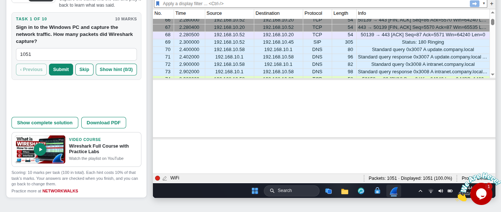

**Answer: 1051.**

---

## Step 2. Find the Call Setup Protocol (Task 2)

I opened **Statistics → Protocol Hierarchy** to see which protocols are in the capture. Two phone protocols appear:

| Protocol                         | Packets | Percent of packets | Percent of bytes |
| -------------------------------- | ------- | ------------------ | ---------------- |
| UDP                              | 857     | 81.5%              | 90.1%            |
| Real-Time Transport Protocol (RTP) | 804   | 76.5%              | 88.7%            |
| Session Initiation Protocol (SIP) | 7      | 0.7%               | 0.6%             |
| TCP                              | 184     | 17.5%              | 9.8%             |
| DNS                              | 46      | 4.4%               | 0.8%             |
| HTTP                             | 20      | 1.9%               | 0.9%             |
| TLS                              | 12      | 1.1%               | 0.3%             |

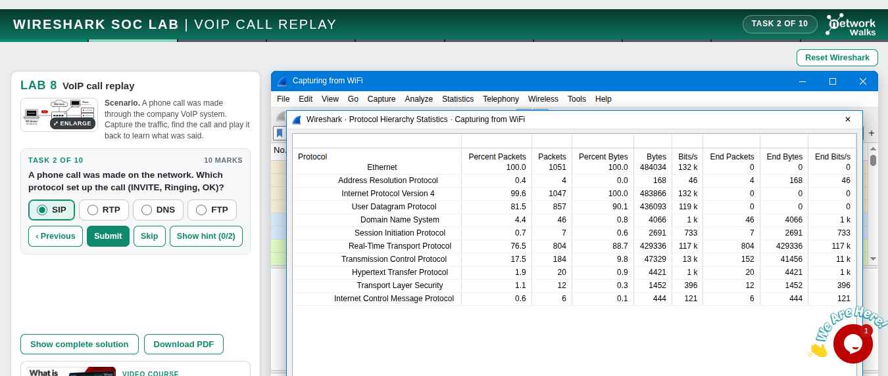

Then I filtered on the setup protocol:

```text
sip
```

The Info column shows the steps of a call: `Request: INVITE`, `Status: 100 Trying`, `Status: 180 Ringing`, `Status: 200 OK`, `Request: ACK`, and at the end `Request: BYE` and `Status: 200 OK`.

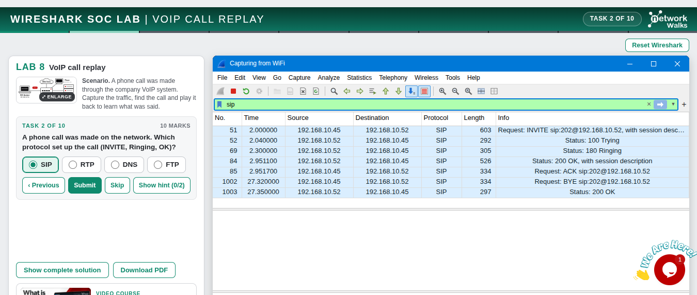

**Answer: SIP.**

---

## Step 3. Find the Voice Protocol (Task 3)

```text
rtp
```

Hundreds of small packets show the same protocol, all `PT=ITU-T G.711 PCMU`, 534 bytes each, about one every 60 ms in each direction. These carry the voice itself.

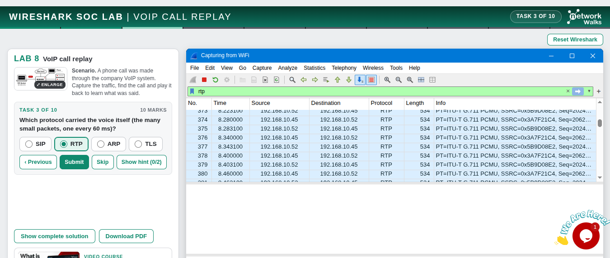

**Answer: RTP.**

---

## Step 4. Find the Caller's Extension (Task 4)

I went back to the `sip` filter and looked at the INVITE (packet 51, `192.168.10.45` to `192.168.10.52`). I submitted **202**, which was wrong (see *Challenges Encountered*). The caller's extension is **101**, shown in the INVITE's `From` line (`sip:101@192.168.10.45`).

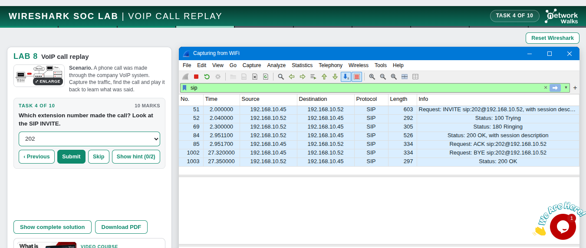

**Correct answer: 101.**

---

## Step 5. Find the Caller's Name (Task 5)

I selected the INVITE (packet 51) and read the SIP message header:

```text
From: "Ali Raza" <sip:101@192.168.10.45>;tag=1928301774
To: "Sara" <sip:202@192.168.10.52>
Call-ID: a84b4c76e66710@192.168.10.45
CSeq: 1 INVITE
Contact: <sip:101@192.168.10.45:5060>
Content-Type: application/sdp
```

The name in quotation marks in the `From` line is the caller: **Ali Raza**.

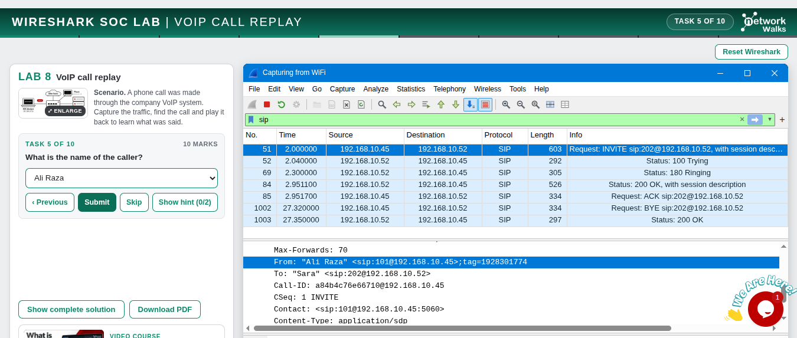

**Answer: Ali Raza.** The same header also shows who is being called: Sara, extension 202.

---

## Step 6. Find the Codec (Task 6)

I clicked an RTP packet (packet 86) and opened the Real-Time Transport Protocol details:

```text
Marker: True
Payload type: ITU-T G.711 PCMU (0)
Sequence number: 20532
Timestamp: 86440
Synchronization Source identifier: 0x3A7F21C4
Payload: 480 bytes
```

The payload type is **PCMU**.

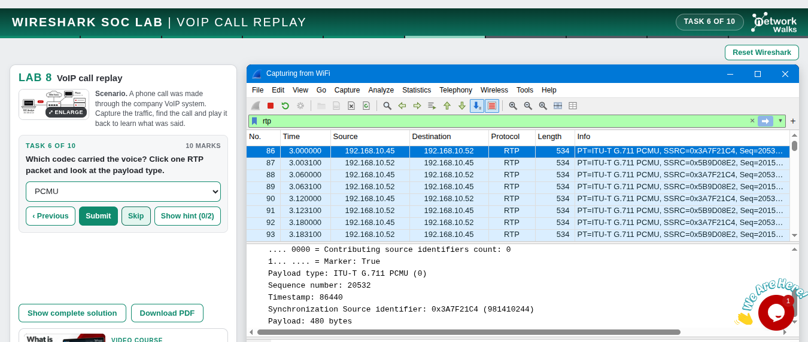

**Answer: PCMU.**

---

## Step 7. Play the Call Back (Tasks 7 to 9)

I opened **Telephony → VoIP Calls**. Wireshark found the call and lists it in one row:

| Start | Stop | Initial speaker | From | To | Protocol | Duration | Packets | State |
| ----- | ---- | --------------- | ---- | -- | -------- | -------- | ------- | ----- |
| 2.000 s | 27.350 s | `192.168.10.45` | `sip:101@192.168.10.45` | `sip:202@192.168.10.52` | SIP | 00:00:25 | 811 | COMPLETED |

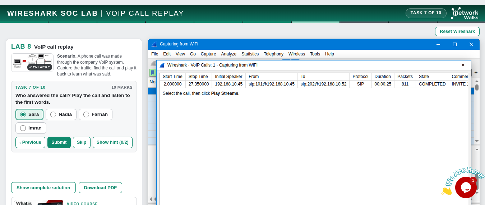

Following the lab's method, the next step is to select the call and use **Play Streams**, then listen. The answers from the audio:

| 🎯 Task | ❓ Question                              | ✅ Answer      |
| ------- | ---------------------------------------- | -------------- |
| 7       | Who answered the call                    | `Sara`         |
| 8       | Last 4 digits of the card number read out | `2394`        |
| 9       | Expiry date the caller said              | `09/28`        |

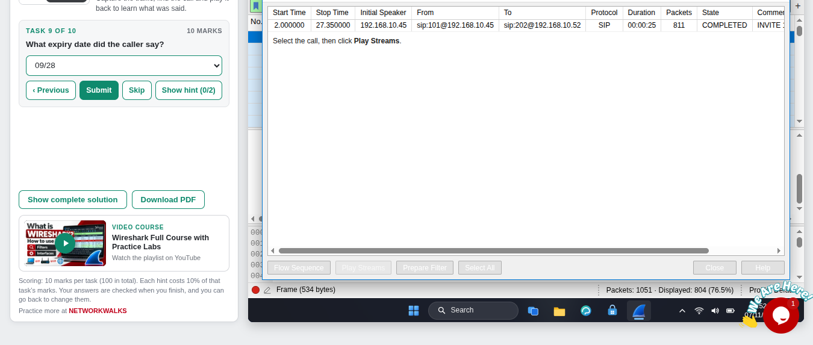

The simulated call includes a payment card number and expiry date spoken out loud, so anyone who could play this call back would hear them.

**Answers: Sara, 2394 and 09/28.**

---

## Step 8. State the Fix (Task 10)

Voice packets (RTP) are sent in clear, but a secure version exists: **SRTP** encrypts the voice packets, and **TLS** protects the SIP messages. Encrypting the call means a sniffer sees only unreadable data.

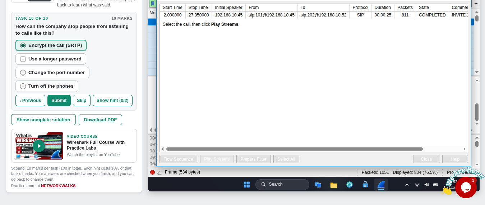

**Answer: Encrypt the call (SRTP).**

---

## Step 9. Result

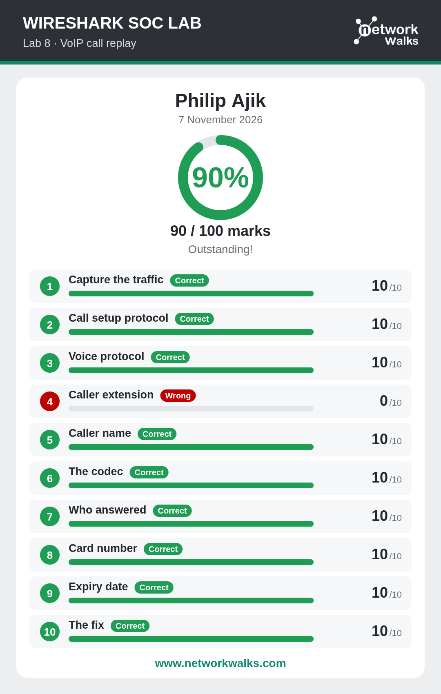

---

# 📊 Results

| #  | 🎯 Task               | ✅ Answer                  | 🔎 How I Found It                                          | 🏆 Result |
| -- | --------------------- | -------------------------- | ---------------------------------------------------------- | --------- |
| 1  | Capture the traffic   | `1051` packets             | Status bar after starting the capture                      | ✅ 10/10  |
| 2  | Call setup protocol   | `SIP`                      | Protocol Hierarchy and the `sip` filter                    | ✅ 10/10  |
| 3  | Voice protocol        | `RTP`                      | `rtp` filter, about 800 small packets                      | ✅ 10/10  |
| 4  | Caller extension      | `101`                      | `From` line of the SIP INVITE                              | ❌ 0/10 (I submitted `202`) |
| 5  | Caller name           | `Ali Raza`                 | Name in quotation marks in the `From` line                 | ✅ 10/10  |
| 6  | The codec             | `PCMU`                     | Payload type in an RTP packet                              | ✅ 10/10  |
| 7  | Who answered          | `Sara`                     | VoIP Calls, playing the call\*                             | ✅ 10/10  |
| 8  | Card number           | ends `2394`                | VoIP Calls, playing the call\*                             | ✅ 10/10  |
| 9  | Expiry date           | `09/28`                    | VoIP Calls, playing the call\*                             | ✅ 10/10  |
| 10 | The fix               | Encrypt the call (SRTP)    | SRTP encrypts the voice packets                            | ✅ 10/10  |

\* The audio itself can't be shown in a screenshot. My screenshots show the VoIP Calls window and my Task 9 answer, and I have no screenshot for Task 8. The answers match the lab's answer key, and my result card marks Tasks 7 to 9 correct.

### Call Flow (from the SIP packets)

| ⏱️ Time (s) | 📦 Packet | 🔄 What happened                                                          |
| ----------- | --------- | ------------------------------------------------------------------------- |
| 2.000       | 51        | `192.168.10.45` sends `INVITE sip:202@192.168.10.52` (with session description) |
| 2.040       | 52        | `192.168.10.52` replies `100 Trying`                                      |
| 2.300       | 69        | `192.168.10.52` replies `180 Ringing`                                     |
| 2.951       | 84        | `192.168.10.52` replies `200 OK` (with session description): answered     |
| 2.952       | 85        | `192.168.10.45` sends `ACK`: the call is set up                           |
| 3.000       | 86        | First RTP voice packet (`192.168.10.45`, marker bit set)                  |
| 27.320      | 1002      | `192.168.10.45` sends `BYE`                                               |
| 27.350      | 1003      | `192.168.10.52` replies `200 OK`: the call is over                        |

---

# 🔭 Observations Beyond the Task Questions

These are things I saw in the screenshots while documenting. The lab does not ask for them.

1. **The call is mostly voice packets.** VoIP Calls reports 811 packets for the call: 7 SIP messages and 804 RTP packets. The call is under 1% signaling, and RTP is 76.5% of the whole capture and 88.7% of its bytes.
2. **There are two voice streams, one in each direction.** The RTP packets show two source identifiers (`0x3A7F21C4` from `192.168.10.45` and `0x5B9D08E2` from `192.168.10.52`), and the packets alternate between them every few milliseconds.
3. **The 60 ms spacing follows from the payload.** Each RTP packet carries 480 bytes. G.711 sends one byte per sample at 8,000 samples per second, so 480 bytes is 60 ms of audio, which matches the packet timing in my screenshot.
4. **The call setup follows a fixed order.** INVITE, 100 Trying, 180 Ringing, 200 OK, ACK, then voice, then BYE and 200 OK. Reading the order in the Info column tells me exactly when the call started, rang, was answered and ended.
5. **The setup messages are readable too.** Even without the audio, the SIP header gives the caller's name and extension, who is being called, and both phones' IP addresses.
6. **The call goes straight between the two phones.** The INVITE is from `192.168.10.45` to `192.168.10.52`, not to the phone server at `192.168.10.20`.
7. **Voice starts at the moment of ACK.** The first RTP packet follows the ACK by less than 50 ms (ACK at 2.952 s, first RTP at 3.000 s).
8. **Spoken details are easy to miss in a capture.** There is no text to search for the card number, because it exists only in the audio. A reader who only looks at packet text would not see it.

---

# 🐞 Challenges Encountered

I had no technical difficulties with Wireshark or the lab environment, and I used no hints. The one thing I got wrong was **Task 4**.

* **Issue:** I submitted **202** as the extension that made the call. The correct answer is **101**.
* **What the evidence showed:** in my screenshot, the SIP list shows `Request: INVITE sip:202@192.168.10.52`. The number in that Info text is the extension being **called**. The caller is in the `From` line: `sip:101@192.168.10.45`. My own Task 5 screenshot shows that line, and it also shows `To: "Sara" <sip:202@192.168.10.52>`.
* **Result:** 0/10 on that task, so the final score was 90/100 instead of 100/100.
* **What I'll do differently:** for a SIP INVITE, check the `From` header for who is calling and the `To` header for who is being called, instead of reading the number in the Info column. I'll also match the answer to the direction the question asks about (caller or callee).

---

# 💡 Key Learnings

1. **A call has two parts:** SIP sets it up, and RTP carries the voice. The first is a handful of packets and the second is hundreds.
2. **The Info column shows the call flow:** INVITE, Trying, Ringing, OK, ACK, BYE. Reading it in order tells the story of the call.
3. **The caller is in `From`, the callee is in `To`:** the number in the INVITE line is the one being called. I lost marks mixing these up.
4. **The codec is in the RTP packet:** the payload type told me the voice was G.711 PCMU.
5. **Wireshark can replay a call:** Telephony → VoIP Calls finds the call and Play Streams lets you listen.
6. **Unencrypted voice exposes whatever is said:** here, a card number and an expiry date were spoken on the call.
7. **The fix is encryption:** SRTP protects the voice and TLS protects the SIP messages, so a sniffer sees only unreadable data. This is the same idea as using HTTPS for web traffic.
8. **Direction matters in every protocol:** Source versus Destination in Lab 3, client versus server in Lab 4, and caller versus callee here. I now check which side the question is asking about.
9. **Document the mistakes too:** the wrong answer taught me more than a perfect score would have.

---

# 🔐 Security & Ethical Use

This lab is for education only and ran in a simulated environment provided by Networkwalks. The names, extensions, card details and addresses in this document are lab data, and I show only the last four digits of the simulated card number. Never record or listen to calls without authorization, and only capture network traffic on networks and devices you own or have permission to monitor.

---

# 🔗 Tools & Resources

- **Online lab:** [https://networkwalks.com/wireshark-lab8/](https://networkwalks.com/wireshark-lab8/)
- **Wireshark:** [https://www.wireshark.org/download.html](https://www.wireshark.org/download.html)
- **NetworkWalks:** [https://networkwalks.com](https://networkwalks.com)

---

# 👤 Author

**Philip Ajik**  
Cybersecurity Student (Batch B082) — Networkwalks Academy  
LinkedIn: [https://www.linkedin.com/in/philip-ajik-a22944384](https://www.linkedin.com/in/philip-ajik-a22944384)

---

## 📌 Project Information

**Program Name:** Cybersecurity at Networkwalks | **Task:** Wireshark SOC Lab 8 | **Project:** VoIP Call Replay | **Repository:** GitHub
